# 🌐 Налаштування та автоматизоване тестування мережевих інтерфейсів і сервісів Linux


Практична робота: діагностика мережі в Linux, фіксація IP-конфігурації та Python-скрипт `network_test.py` для автоматизованого моніторингу хостів, портів і мережевих сервісів.

| | |
|---|---|
| **Автор** | `Бовсунівський Владислав` |
| **Група** | `РС-31` |
| **Дисципліна** | `Вбудовані системи на базі ОС Linux` |
| **Дата виконання** | 10.11.2026 |
| **Середовище** | Debian GNU/Linux у WSL2 (хост `DESKTOP-ORUP6B1`, користувач `vladDos`) |

---

## 📑 Зміст

1. [Мета роботи](#-мета-роботи)
2. [Топологія](#-топологія)
3. [Хід роботи](#-хід-роботи)
   - [3.1 Ідентифікація інтерфейсів](#31-ідентифікація-мережевих-інтерфейсів)
   - [3.2 Маршрутизація та ARP-таблиця](#32-маршрутизація-та-arp-таблиця)
   - [3.3 Аудит відкритих портів](#33-аудит-відкритих-портів)
   - [3.4 Активні сесії](#34-активні-сесії)
   - [3.5 Статична IP-адреса](#35-фіксація-мережевої-конфігурації)
   - [3.6 Скрипт network_test.py](#36-скрипт-валідації-network_testpy)
4. [Аналіз результатів](#-аналіз-результатів)
5. [Структура репозиторію](#-структура-репозиторію)
6. [Відтворення](#-відтворення)
7. [Артефакти для захисту](#-артефакти-для-захисту)

---

## 🎯 Мета роботи

Опанувати інструменти діагностики мережі в ОС Linux, конфігурацію IP-адресації та розробити Python-скрипт для автоматизованого моніторингу активних хостів, відкритих портів і доступності мережевих сервісів (SSH, TCP-потік даних SDR, API телеметрії).

## 🗺 Топологія

```
                  ┌──────────────────────────────┐
                  │  Windows-хост (Hyper-V NAT)  │
                  │  Шлюз: 172.21.112.1          │
                  │  MAC : 00:15:5d:4d:47:42     │
                  └──────────────┬───────────────┘
                                 │  172.21.112.0/20
                                 │
                  ┌──────────────┴───────────────┐
                  │  Debian (WSL2) — «плата»     │
                  │  eth0: 172.21.120.120/20     │
                  │  MAC : 00:15:5d:73:5b:d0     │
                  │  Сервіси: 22 · 8000 · 1234   │
                  └──────────────────────────────┘
```

| Вузол | IP-адреса | MAC-адреса | Роль |
|---|---|---|---|
| Debian (WSL2) | `172.21.120.120/20` | `00:15:5d:73:5b:d0` | Досліджувана система (інтерфейс `eth0`) |
| Шлюз | `172.21.112.1` | `00:15:5d:4d:47:42` | Windows-хост, NAT для WSL2 |
| Loopback | `127.0.0.1/8` | — | Локальний інтерфейс `lo` |

Параметри підмережі: маска `255.255.240.0` (`/20`), broadcast `172.21.127.255`, MTU `1280`.

### Призначення відкритих портів

| Порт | Протокол | Процес (PID) | Призначення |
|---|---|---|---|
| **22** | TCP | `sshd` (2516) | SSH-доступ |
| **8000** | TCP | `python3` (2676) | API телеметрії (тестовий `http.server`) |
| **1234** | TCP | `nc` (2677) | TCP-потік даних SDR (тестовий `netcat`) |
| 3389 | TCP | `xrdp` (189) | Віддалений робочий стіл (RDP) |
| 53 | TCP/UDP | — (`10.255.255.254`) | DNS-проксі WSL |
| 5353 | UDP | `avahi-daemon` (137) | mDNS |
| 323 | UDP | — (`127.0.0.1`, `::1`) | Керуючий порт служби часу (chrony) |

---

## 🔧 Хід роботи

### 3.1 Ідентифікація мережевих інтерфейсів

Команди: `ip a`, `ifconfig`.

```text
2: eth0: <BROADCAST,MULTICAST,UP,LOWER_UP> mtu 1280 qdisc mq state UP group default qlen 1000
    link/ether 00:15:5d:73:5b:d0 brd ff:ff:ff:ff:ff:ff
    inet 172.21.120.120/20 brd 172.21.127.255 scope global eth0
    inet6 fe80::215:5dff:fe73:5bd0/64 scope link
```

| Інтерфейс | Стан | IPv4 | MAC |
|---|---|---|---|
| `lo` | UP | `127.0.0.1/8`, `10.255.255.254/32` | `00:00:00:00:00:00` |
| `eth0` | UP | `172.21.120.120/20` | `00:15:5d:73:5b:d0` |

> MAC-адреса з префіксом `00:15:5d` належить віртуальним адаптерам Hyper-V, що підтверджує віртуалізоване оточення.

📸 `screenshots/01-ip-a.png` · `screenshots/02-ifconfig.png`

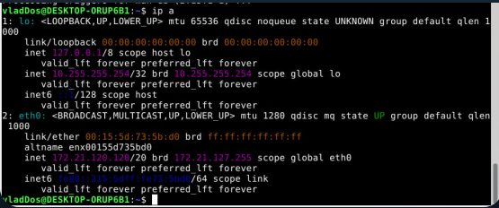
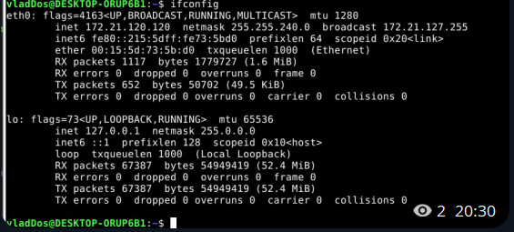

### 3.2 Маршрутизація та ARP-таблиця

```bash
ip route
ping -c 2 $(ip route | awk '/default/ {print $3}')   # «розбудити» шлюз
ip neigh | tee ip_neigh.txt
```

```text
default via 172.21.112.1 dev eth0 proto kernel
172.21.112.0/20 dev eth0 proto kernel scope link src 172.21.120.120

172.21.112.1 dev eth0 lladdr 00:15:5d:4d:47:42 STALE
```

**Висновок:** шлюз `172.21.112.1` присутній в ARP-кеші з відомою MAC-адресою, тобто канальний (L2) рівень працює коректно. Стан `STALE` означає, що запис відомий, але давно не підтверджувався.

> ⚠️ ICMP-ping до шлюзу дав `100% packet loss`, хоча ARP-запис існує. Імовірна причина: брандмауер Windows блокує ICMP на віртуальному адаптері Hyper-V. Це не означає, що канал не працює.

📸 `screenshots/03-ip-route.png` · `screenshots/04-arp-ping.png`

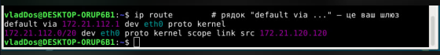
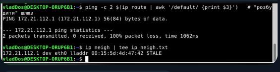

### 3.3 Аудит відкритих портів

Для перевірки спочатку запущено тестові сервіси:

```bash
sudo service ssh start            # порт 22
python3 -m http.server 8000 &     # порт 8000 — API телеметрії
nc -l -p 1234 &                   # порт 1234 — потік SDR
```

Аудит: `ss -tuln` (порти) та `sudo ss -tulpn` (порти + процеси).

```text
Netid State   Recv-Q Send-Q   Local Address:Port   Peer Address:Port
tcp   LISTEN  0      1              0.0.0.0:1234         0.0.0.0:*     users:(("nc",pid=2677,fd=3))
tcp   LISTEN  0      128            0.0.0.0:22           0.0.0.0:*     users:(("sshd",pid=2516,fd=6))
tcp   LISTEN  0      1000     10.255.255.254:53          0.0.0.0:*
tcp   LISTEN  0      5              0.0.0.0:8000         0.0.0.0:*     users:(("python3",pid=2676,fd=3))
tcp   LISTEN  0      128               [::]:22              [::]:*     users:(("sshd",pid=2516,fd=7))
tcp   LISTEN  0      2                    *:3389               *:*     users:(("xrdp",pid=189,fd=13))
```

Цільові порти **22**, **8000**, **1234** виділено на скриншоті червоним.

📸 `screenshots/05-test-services.png` · `screenshots/06-ss-tuln.png` · `screenshots/07-ss-tulpn.png`

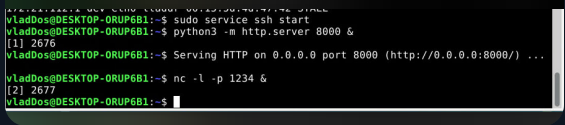
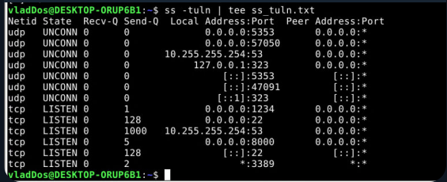
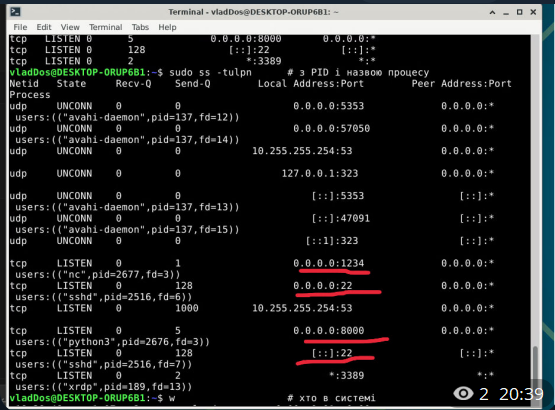

### 3.4 Активні сесії

Команда `w` показує, хто зараз працює в системі:

```text
 18:38:48 up  1:07,  2 users,  load average: 0.00, 0.01, 0.00
USER     TTY      FROM    LOGIN@   IDLE   JCPU   PCPU  WHAT
vladDos  :1       :1      17:13    ?      0.00s  ?     xrdp-sesexec
vladDos  pts/1    -       17:12    1:26m  0.00s  ?     -bash
```

Дві сесії належать одному користувачу: графічна (через xrdp) і термінальна. Сторонніх підключень немає.

📸 `screenshots/08-w.png`

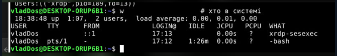

### 3.5 Фіксація мережевої конфігурації

У WSL2 IP-адресу видає Windows (NAT), а мережеві файли перегенеровуються при кожному запуску. Тому `netplan` і `dhcpcd` тут не діють. Для демонстрації адресу додано **тимчасово**:

```bash
sudo ip addr add 172.20.0.50/20 dev eth0
ip a          # перевірка
```

Результат: на `eth0` з'явилася друга адреса `172.20.0.50/20 scope global eth0` поряд з `172.21.120.120/20`. Після перезапуску WSL вона зникне.

Для реальної плати підготовлено приклади постійної конфігурації:

- [`configs/netplan-static.yaml`](configs/netplan-static.yaml) — Ubuntu / Netplan
- [`configs/dhcpcd.conf`](configs/dhcpcd.conf) — Raspberry Pi OS / Debian

📸 `screenshots/09-static-ip.png`

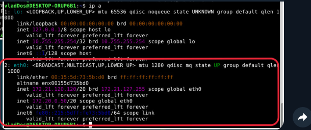

### 3.6 Скрипт валідації `network_test.py`

Скрипт [`network_test.py`](network_test.py) виконує комплексний аудит і складається з шести блоків:

| № | Блок | Джерело даних |
|---|---|---|
| 1 | Порти в стані **LISTEN** з підписами сервісів | `ss -tuln` |
| 2 | З'єднання в стані **ESTABLISHED** | `ss -tun state established` |
| 3 | Шлюз за замовчуванням і сусіди з **ARP-кешу** (без перебору підмережі) | `ip route`, `ip -4 neigh` |
| 4 | **ICMP-ping** і **TCP-перевірка** критичних портів (22, 80, 8000, 1234) | `ping`, `socket.connect_ex` |
| 5 | Активні сесії користувачів | `w` |
| 6 | Процеси, що тримають порти | `sudo ss -tulpn` |

Запуск:

```bash
python3 network_test.py
```

Результат виконання:

- блок 1 показав LISTEN-порти, зокрема `1234 ← TCP-потік SDR`, `22 ← SSH`, `8000 ← API телеметрії`;
- блок 2 показав активні RDP-з'єднання на порт 3389 (через `::1`);
- блок 3 знайшов шлюз `172.21.112.1` з MAC `00:15:5d:4d:47:42` у стані `STALE`;
- блок 4 позначив шлюз як `DOWN` (ICMP не відповідає, див. [аналіз](#-аналіз-результатів));
- блоки 5 і 6 вивели сесії та процеси з PID.

📸 `screenshots/10-network-test-1.png` · `screenshots/11-network-test-2.png`

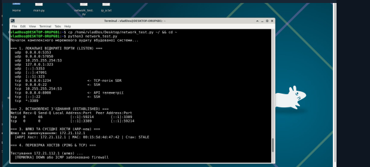
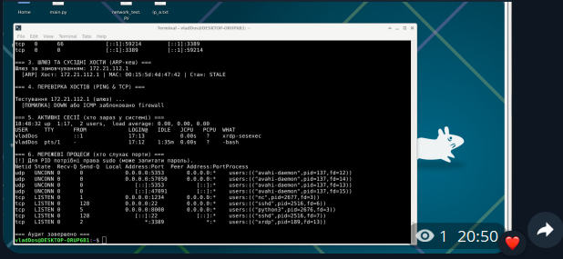

---

## 📊 Аналіз результатів

| Перевірка | Результат | Коментар |
|---|---|---|
| L2-рівень | ✅ Працює | Шлюз у ARP-кеші з MAC-адресою |
| Інтерфейс `eth0` | ✅ UP | IP `172.21.120.120/20` |
| Маршрут за замовчуванням | ✅ Є | `via 172.21.112.1` |
| ICMP до шлюзу | ❌ 100% втрат | Ймовірно, фільтрація на стороні Windows |
| SSH (22) | ✅ LISTEN | `sshd`, IPv4 та IPv6 |
| API (8000), SDR (1234) | ✅ LISTEN | Тестові сервіси |

**Обмеження скрипта.** Статус `DOWN` означає лише «немає відповіді на ICMP». Хост з ARP-записом і закритим ICMP скрипт позначить як недоступний, тому TCP-перевірку портів для нього пропущено. Можливе покращення: перевіряти порти незалежно від результату ping.

**Безпека.** Сервіси на `0.0.0.0` (22, 8000, 1234) доступні з усіх інтерфейсів. Після завершення роботи тестові сервіси варто зупинити:

```bash
kill 2676 2677            # http.server і nc
sudo service ssh stop
```

---

## 📁 Структура репозиторію

```text
.
├── README.md               # цей звіт
├── network_test.py         # скрипт мережевого аудиту
├── collect_logs.sh         # збирає всі виводи команд у logs/
├── configs/
│   ├── netplan-static.yaml # статична IP (Ubuntu)
│   └── dhcpcd.conf         # статична IP (Raspberry Pi OS / Debian)
├── logs/                   # текстові виводи команд (генерує collect_logs.sh)
└── screenshots/            # скриншоти до розділів звіту
```

## ▶️ Відтворення

```bash
# 1. Залежності
sudo apt update
sudo apt install -y iproute2 net-tools iputils-ping wireless-tools netcat-openbsd openssh-server python3

# 2. Тестові сервіси
sudo service ssh start
python3 -m http.server 8000 &
nc -l -p 1234 &

# 3. Збір логів і запуск аудиту
chmod +x collect_logs.sh
./collect_logs.sh
```

